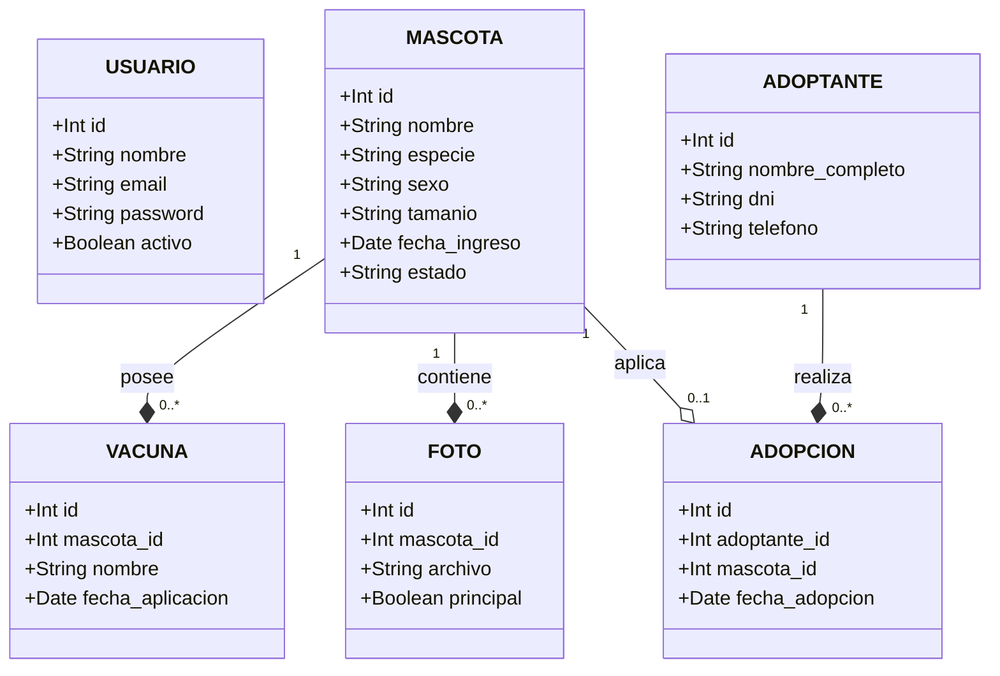

# Modelo de Datos y Diccionario Formal

El sistema guarda su información en seis tablas principales y dos de control. Este documento explica la estructura lógica de la base de datos MySQL 8 utilizando un diccionario formal que especifica restricciones de dominio, eliminando ambigüedades semánticas.

---

### Diagrama Entidad-Relación Completo (Notación UML)

Para visualizar las cardinalidades y asociaciones físicas del modelo relacional, se implementa el siguiente mapa bajo el estándar solicitado:

---

### Diccionario de Datos del Sistema

#### 1. Tabla: `usuario`
Las personas que trabajan en el refugio y administran la plataforma.

| Campo | Tipo de Dato | Restricciones / Dominio | Descripción Técnica |
| :--- | :--- | :--- | :--- |
| `id` | `INT` | PRIMARY KEY, AUTO_INCREMENT | Identificador único y correlativo. |
| `nombre` | `VARCHAR(100)`| NOT NULL | Nombre y apellido, para mostrar en pantalla. |
| `email` | `VARCHAR(150)`| NOT NULL, UNIQUE | Correo electrónico con el que inicia sesión. |
| `password` | `VARCHAR(255)`| NOT NULL | Clave de acceso encriptada en el servidor. |
| `activo` | `BOOLEAN` | DEFAULT TRUE | Estado lógico para dar de baja sin borrar filas. |

*   **Por qué la contraseña va encriptada:** Si alguien accede a la base, no puede leer las credenciales. Spring Security (BCrypt) las transforma al guardar y las compara de forma segura.
*   **Por qué no hay una columna de rol:** Todos los usuarios realizan las mismas acciones administrativas en un refugio chico.

#### 2. Tabla: `mascota`
El animal. Es la entidad central del circuito de trazabilidad.

| Campo | Tipo de Dato | Restricciones / Dominio | Descripción Técnica |
| :--- | :--- | :--- | :--- |
| `id` | `INT` | PRIMARY KEY, AUTO_INCREMENT | Identificador único e inmutable del animal. |
| `nombre` | `VARCHAR(80)` | NOT NULL | Nombre de pila asignado por el refugio. |
| `especie` | `VARCHAR(20)` | FK -> `especie_dicc` / `['PERRO', 'GATO']` | Clasificación taxonómica para filtros de búsqueda. |
| `sexo` | `VARCHAR(10)` | CHECK (`'MACHO'`, `'HEMBRA'`) | Género biológico verificado del ejemplar. |
| `tamanio` | `VARCHAR(10)` | CHECK (`'CHICO'`, `'MEDIANO'`, `'GRANDE'`) | Escala de contextura física del animal. |
| `fecha_nacimiento_aprox`| `DATE` | NULL | Fecha aproximada estimada por el veterinario. |
| `fecha_ingreso`| `DATE` | NOT NULL | Fecha calendario de su rescate o ingreso. |
| `descripcion` | `TEXT` | NULL | Notas libres sobre temperamento o particularidades. |
| `estado` | `VARCHAR(30)` | FK -> `estado_dicc` | Situación del animal en el circuito operativo. |

*   **Por qué la fecha de nacimiento puede estar vacía:** A un animal rescatado de la calle no se le conoce la edad exacta de forma inmediata; obligar a meter un dato falso daña las métricas. Se calcula la edad de forma dinámica en la vista para evitar desactualizaciones anuales.
*   **Por qué el estado usa claves foráneas:** Se restringen contra tablas diccionarios fijas (`DISPONIBLE`, `EN_PROCESO`, `ADOPTADO`, `NO_DISPONIBLE`) para asegurar que no se carguen estados inválidos por error humano.

#### 3. Tabla: `vacuna`
Cada aplicación de una dosis sanitaria.

| Campo | Tipo de Dato | Restricciones / Dominio | Descripción Técnica |
| :--- | :--- | :--- | :--- |
| `id` | `INT` | PRIMARY KEY, AUTO_INCREMENT | Identificador único de la transacción médica. |
| `mascota_id` | `INT` | FK -> `mascota(id)` ON DELETE CASCADE | Vínculo con el animal receptor de la dosis. |
| `nombre` | `VARCHAR(100)`| NOT NULL | Nombre comercial o tipo de vacuna aplicada. |
| `fecha_aplicacion`| `DATE` | NOT NULL | Fecha calendario de la inoculación. |
| `proxima_dosis` | `DATE` | NULL | Fecha sugerida para el refuerzo sanitario. |
| `observaciones` | `TEXT` | NULL | Comentarios clínicos libres del profesional. |

*   **Por qué una tabla aparte:** Un animal recibe múltiples vacunas en su ciclo de vida. Si fuera una columna fija en `mascota`, cada dosis nueva pisaría los registros anteriores perdiendo el historial clínico.

#### 4. Tabla: `foto`
Referencias de imágenes asociadas a los animales.

| Campo | Tipo de Dato | Restricciones / Dominio | Descripción Técnica |
| :--- | :--- | :--- | :--- |
| `id` | `INT` | PRIMARY KEY, AUTO_INCREMENT | Identificador único de la imagen. |
| `mascota_id` | `INT` | FK -> `mascota(id)` ON DELETE CASCADE | Vínculo con el animal retratado. |
| `archivo` | `VARCHAR(255)`| NOT NULL | Ruta o nombre del archivo almacenado en disco. |
| `principal` | `BOOLEAN` | DEFAULT FALSE | Bandera para determinar la portada del catálogo. |

*   **Por qué se guarda la referencia:** Alojar archivos binarios (*BLOB*) directo en la base de datos degrada la velocidad de las consultas síncronas. Se opta por guardar la imagen en el sistema de archivos del servidor y persistir solo el string de referencia.

#### 5. Tabla: `adoptante`
Registro formal de civiles interesados en adoptar.

| Campo | Tipo de Dato | Restricciones / Dominio | Descripción Técnica |
| :--- | :--- | :--- | :--- |
| `id` | `INT` | PRIMARY KEY, AUTO_INCREMENT | Identificador del ciudadano aspirante. |
| `nombre_completo`| `VARCHAR(100)`| NOT NULL | Nombre y apellido del interesado. |
| `dni` | `VARCHAR(20)` | NOT NULL, UNIQUE | Documento nacional indispensable para actas de adopción. |
| `telefono` | `VARCHAR(30)` | NOT NULL | Teléfono de contacto directo. |
| `direccion` | `VARCHAR(255)`| NOT NULL | Domicilio requerido para visitas de seguimiento. |

#### 6. Tabla: `adopcion`
El contrato operativo que une al adoptante con el animal de forma unívoca.

| Campo | Tipo de Dato | Restricciones / Dominio | Descripción Técnica |
| :--- | :--- | :--- | :--- |
| `id` | `INT` | PRIMARY KEY, AUTO_INCREMENT | Identificador único del trámite legal. |
| `adoptante_id` | `INT` | FK -> `adoptante(id)` ON DELETE RESTRICT | Persona externa que adoptó al animal. |
| `mascota_id` | `INT` | FK -> `mascota(id)`, UNIQUE | Mascota transferida a la familia. |
| `fecha_adopcion`| `DATE` | NOT NULL | Fecha exacta de la entrega del animal. |
| `notas_seguimiento`| `TEXT` | NULL | Historial de auditorías de bienestar animal. |

*   **Por qué `mascota_id` es UNIQUE:** Bloquea por completo la posibilidad de que un animal sufra dos procesos de adopción concurrentes por un error del operador.
*   **Por qué `adoptante_id` usa RESTRICT:** Impide borrar accidentalmente a una persona de la base de datos si tiene actas o animales vinculados bajo su responsabilidad.

---

## Alcance y Exclusiones del Modelo

*   **Sin Auditoría de Estados:** No guardamos el histórico de cambios de estados intermedios. El estado se sobreescribe directamente en la entidad `mascota` a excepción del paso a `ADOPTADO`, que queda registrado en la tabla transaccional `adopcion`.
*   **Monorrefugio:** El modelo está diseñado para operar con un único esquema centralizado, omitiendo la partición multi-inquilino (*multi-tenant*).
                                                         